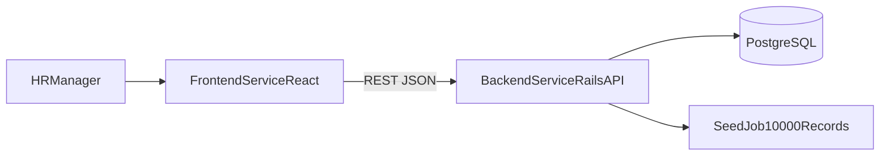

# Architecture Notes

## System Overview

## Data Model
- `employees` table stores identity, compensation, role, and employment metadata.
- Indexes on `country`, `job_title`, and `(country, job_title)` optimize insights.

## Backend Layers
- Controllers expose API resources and insight endpoints.
- Service objects compute metrics for testable and maintainable query logic.
- ActiveRecord model enforces domain validation.

## Frontend Layers
- Route-driven pages:
  - `EmployeesPage`
  - `SalaryInsightsPage`
- Reusable components:
  - `EmployeeForm`
  - `EmployeeTable`
- API client abstracts fetch and error handling.
